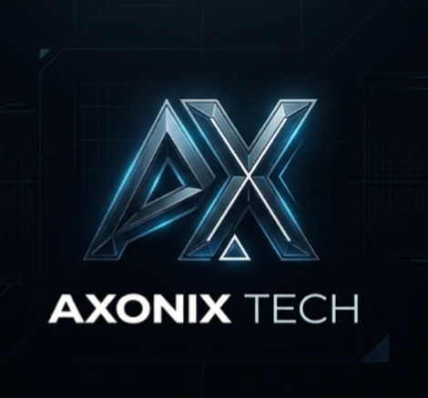

<div align="center">



<p><strong>SPATIAL DESIGN · DIGITAL ENGINEERING · HUMAN-FIRST EXPERIENCES</strong></p>

# AXONIX TECH

### YOUR VISION. OUR CODE.

**Premium websites, presentation design, and practical chatbots for growing brands.**

[](https://nextjs.org/)
[](https://react.dev/)
[](https://www.typescriptlang.org/)
[](https://tailwindcss.com/)
[](https://developer.mozilla.org/en-US/docs/Web/CSS)

[Website](https://axonix-tech-gamma.vercel.app) · [Services](https://axonix-tech-gamma.vercel.app/services) · [Concept work](https://axonix-tech-gamma.vercel.app/work) · [Contact](https://axonix-tech-gamma.vercel.app/contact)

</div>

---

## 01 / Studio overview

**Axonix Tech** is an independent digital studio based in Jaipur, India. We design and build mobile-first websites, landing pages, presentation decks, and website chatbots for businesses, institutes, restaurants, students, and growing brands.

The site pairs a restrained midnight-and-cyan palette with a **spatial, 4D-inspired visual language**: layered interface surfaces, orbiting forms, pointer-responsive depth, and time-based motion. The hero's dimensional artwork is built with CSS and the existing brand mark—there is no WebGL or 3D-engine dependency.

> **Design intent:** high depth, not high noise. Motion supports the content; it does not replace clarity, responsiveness, or accessibility.

## 02 / Engineering profile

| Layer | Implementation |
| --- | --- |
| Application | Next.js App Router, React, TypeScript |
| Styling | Tailwind CSS plus a custom CSS motion and depth system |
| Visual depth | CSS perspective, layered transforms, ambient gradients, parallax offsets |
| Interaction | Pointer tilt, spotlight borders, scroll reveals, tap ripples, animated service marquee |
| Navigation | Responsive top navigation with an accessible mobile side drawer |
| Icons | Lucide React |
| Deployment target | Vercel or another Node.js-compatible Next.js host |

### Spatial motion system

- **Hero core:** layered Axonix identity visual with animated orbital paths and floating interface cards.
- **Pointer depth:** selected surfaces respond to cursor position with restrained tilt, spotlight, and per-layer parallax.
- **Scroll and tap feedback:** shared reveal and ripple effects are applied through `components/MotionEffects.tsx`.
- **Motion accessibility:** motion is reduced or disabled when the visitor requests reduced motion.
- **Performance approach:** the dimensional hero is DOM/CSS-based; canvas animation is reserved for the `/links` neural background.

> “4D-inspired” describes the visual treatment—depth plus motion over time. This project is not a literal four-dimensional renderer or VR experience.

## 03 / Interface palette

| Token | Value | Role |
| --- | --- | --- |
| Obsidian | `#070A12` | Main canvas |
| Deep surface | `#0B1220` | Navigation and elevated sections |
| Card surface | `#10192A` | Interactive panels |
| Electric cyan | `#52D8F0` | Primary accent and focus states |
| Ice accent | `#B1F4F7` | Highlights and luminous details |
| Border | `#1B2940` | Low-contrast separators |
| Primary text | `#F3F6FA` | Headings and essential information |
| Secondary text | `#A8B4C4` | Supporting content |

The Tailwind palette lives in `tailwind.config.ts`; shared interaction, depth, and responsive rules live in `app/globals.css`.

## 04 / Routes

| Route | Purpose |
| --- | --- |
| `/` | Studio homepage, spatial hero, services, concepts, pricing, process, FAQs |
| `/services` | Service descriptions, standards, pricing, and FAQs |
| `/work` | Restaurant, coaching, and technology concept projects |
| `/work/presentations` | Presentation design samples |
| `/about` | Studio approach, principles, and technology foundation |
| `/contact` | Project brief and direct contact options |
| `/links` | Compact link hub for social bio traffic |
| `/privacy` | Privacy policy |
| `/demo/business` | Local business / clinic website demonstration |
| `/demo/chatbot` | Interactive rule-based chatbot demonstration |
| `/demo/coaching` | Coaching institute website demonstration |
| `/demo/restaurant` | Restaurant website demonstration |

Concept projects are demonstrations, not client case studies. Any example metrics shown inside a mockup are illustrative.

## 05 / Project structure

```text
axonix-tech/
├── app/
│   ├── about/page.tsx
│   ├── contact/page.tsx
│   ├── demo/
│   │   ├── business/page.tsx
│   │   ├── chatbot/page.tsx
│   │   ├── coaching/page.tsx
│   │   └── restaurant/page.tsx
│   ├── links/page.tsx
│   ├── privacy/page.tsx
│   ├── services/page.tsx
│   ├── work/
│   │   ├── page.tsx
│   │   └── presentations/page.tsx
│   ├── globals.css
│   ├── layout.tsx
│   ├── page.tsx
│   ├── icon.tsx
│   ├── opengraph-image.tsx
│   ├── robots.ts
│   └── sitemap.ts
├── components/
│   ├── AxVisual.tsx
│   ├── BrandLogo.tsx
│   ├── ContactForm.tsx
│   ├── DeckViewer.tsx
│   ├── FAQSection.tsx
│   ├── Footer.tsx
│   ├── MotionEffects.tsx
│   ├── Navbar.tsx
│   ├── PricingSection.tsx
│   ├── ProjectCard.tsx
│   ├── ServiceCard.tsx
│   └── ...shared experience components
├── lib/site.ts
├── public/
│   ├── icon.svg
│   └── logo.png
├── package.json
├── tailwind.config.ts
└── tsconfig.json
```

## 06 / Run locally

### Requirements

- Node.js 18.17 or later (Node.js 20 LTS recommended)
- npm

### Install and start

```bash
git clone https://github.com/axonixtech01-cpu/axonix-tech.git
cd axonix-tech
npm ci
npm run dev
```

Open `http://localhost:3000` in your browser.

### Production build

```bash
npm run build
npm run start
```

`npm run build` performs the Next.js production build, TypeScript checks, and static page generation. The project was verified with this command.

## 07 / Deploy

1. Import the GitHub repository into Vercel.
2. Select **Next.js** as the framework and `./` as the root directory.
3. Leave the output directory on the Next.js default.
4. Deploy. No environment variables are required for the core website.

The configured canonical URL is set in `lib/site.ts` as `SITE_URL`. Update it if the production domain changes.

### Optional privacy-friendly analytics

Analytics scripts load only when configured. Add only the provider values you use in the hosting dashboard:

| Variable | Purpose |
| --- | --- |
| `NEXT_PUBLIC_UMAMI_WEBSITE_ID` | Enables Umami page views and named interaction events |
| `NEXT_PUBLIC_UMAMI_SCRIPT_URL` | Optional custom Umami script URL |
| `NEXT_PUBLIC_CF_BEACON_TOKEN` | Enables Cloudflare Web Analytics |

Without these values the analytics component renders no third-party analytics script.

## 08 / Privacy and data flow

- The project brief is assembled in the visitor's browser. The visitor chooses whether to copy it, open an email draft, or continue to Instagram.
- There is no project-brief API or database in this repository.
- The chatbot and client-business demo pages are illustrative browser experiences; they do not submit or persist demo input.
- See [`/privacy`](https://axonix-tech-gamma.vercel.app/privacy) for the visitor-facing policy.

## 09 / Maintenance notes

- **Brand colors and Tailwind tokens:** `tailwind.config.ts`
- **Global styles, responsive rules, and motion:** `app/globals.css`
- **Site metadata and canonical domain:** `app/layout.tsx` and `lib/site.ts`
- **Navigation and mobile drawer:** `components/Navbar.tsx`
- **Homepage content and featured concepts:** `app/page.tsx`
- **Public logo and icon assets:** `public/`

Keep interactive motion subtle, test at narrow mobile widths, and preserve the reduced-motion styles when adding animations.

## 10 / Contact

- **Email:** [Axonix.tech01@gmail.com](mailto:Axonix.tech01@gmail.com)
- **Instagram:** [@axo_nixtech](https://www.instagram.com/axo_nixtech/)
- **Studio:** US, Germany, India

<div align="center">

---

<sub>© 2026 Axonix Tech · YOUR VISION. OUR CODE.</sub>

</div>
